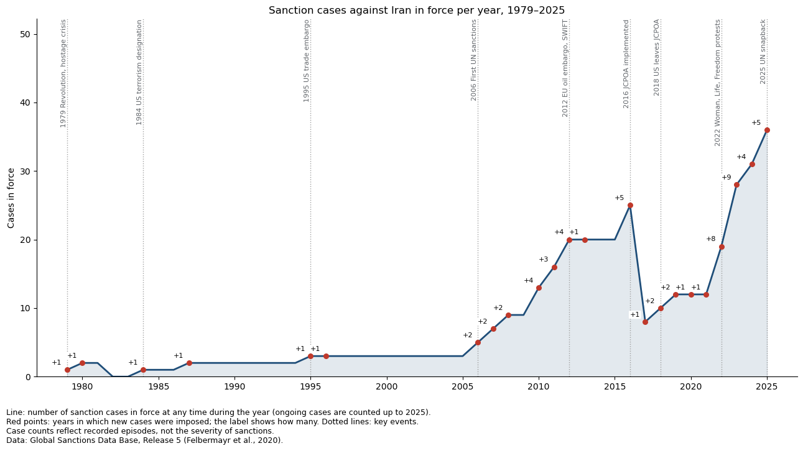
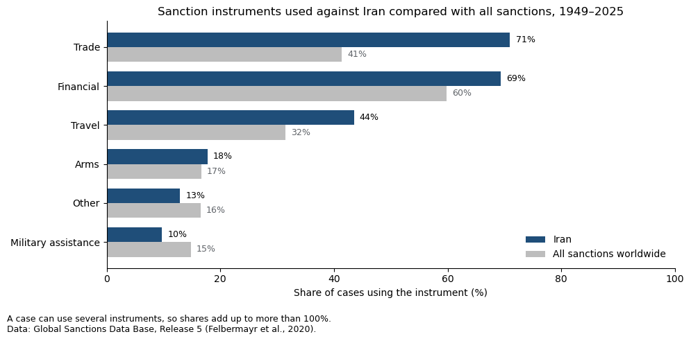
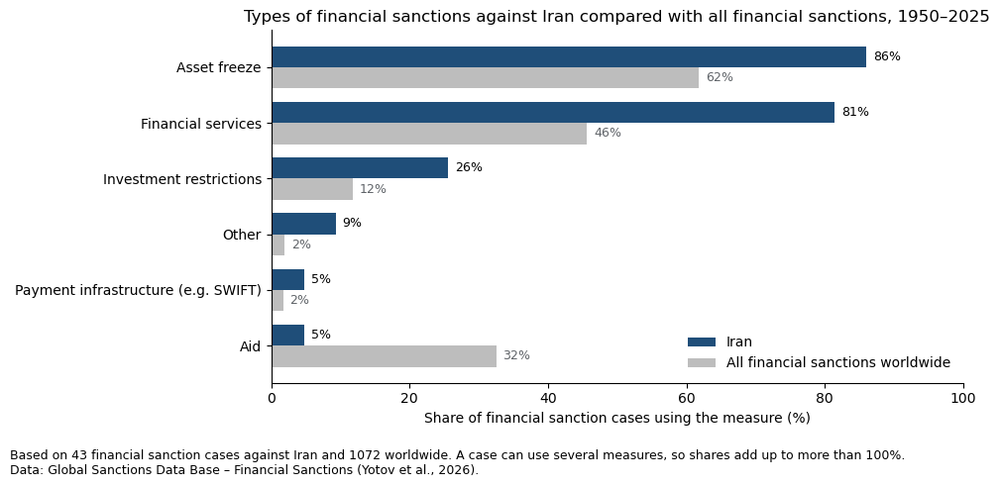
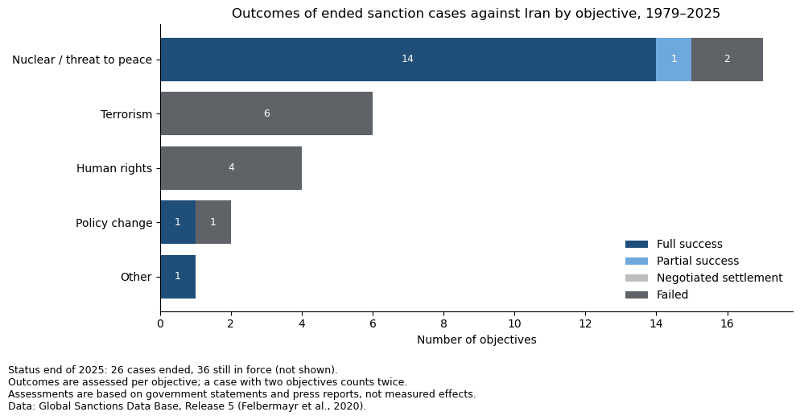

# Sanktionen gegen den Iran, 1979–2025

🇬🇧 [English version](README.md)

Analyse aller erfassten Sanktionsfälle gegen den Iran und ihre Einordnung in das weltweite Sanktionsgeschehen,
auf Grundlage der Global Sanctions Data Base (GSDB): wer Sanktionen verhängt hat, mit welchen Instrumenten, aus welchen Gründen und mit welchem Ergebnis.

## Interaktives Dashboard

**[Dashboard öffnen](https://iran-sanctions-analysis.streamlit.app/)**: alle Ergebnisse interaktiv, auf Deutsch und Englisch.
Zum lokalen Starten siehe [Ausführen](#ausführen).

## Fragen und Ergebnisse

### 1. Wie haben sich die Sanktionen gegen den Iran entwickelt, und wer hat sie verhängt?

- Der Iran ist das **am zweithäufigsten sanktionierte Land** der Welt: 62 Fälle seit 1979, nach Russland (75).
- 1979–2005: meist 1–3 Fälle in Kraft, keiner 1982–1983; alle von den USA.
- 2006–2015: starker Anstieg im Atomstreit (UN, EU und andere), bis zu 20 Fälle in Kraft (2012–2015).
- 2016: Mit der Umsetzung des Atomabkommens (JCPOA) im Januar 2016 endeten 13 Fälle; Ende 2016 waren nur noch 7 in Kraft.
  Die Grafik zählt jeden Fall, der in einem Jahr zumindest zeitweise in Kraft war; deshalb zeigt sie für 2016 25 Fälle und den Rückgang erst 2017.
- 2018–2025: erneuter Anstieg nach dem US-Ausstieg, Höchststand von **36 Fällen in Kraft im Jahr 2025**.
- Die USA haben 25 der 62 Fälle verhängt. China, Russland, Indien, Saudi-Arabien und die Türkei sind nicht als Sender eines Falls gegen den Iran erfasst (UN-Fälle werden getrennt gezählt).

[](images/timeline.png)

### 2. Welche Instrumente wurden eingesetzt?

- Handelssanktionen sind gegen den Iran viel häufiger als weltweit (71 % gegenüber 41 % der Fälle).
- Finanzsanktionen stiegen von jedem dritten neuen Fall (1979–2005) auf fast neun von zehn (2017–2025).
- Unter den 43 Fällen mit Finanzsanktionen dominieren Vermögenssperren (86 %) und Verbote von Finanzdienstleistungen (81 %). Beschränkungen der Zahlungsinfrastruktur (z. B. SWIFT) sind nur in zwei Fällen erfasst, beide durch die EU (2012, 2025).

[](images/instruments.png)
[](images/financial_measures.png)

### 3. Warum wurden Sanktionen verhängt, und wie endeten sie?

- Erklärte Ziele (ein Fall kann mehrere haben): Atomprogramm / Friedensbedrohung 24, Politikwechsel 16, Menschenrechte 15, Terrorismus 14, sonstige Ziele 8.
- Ende 2025 sind 36 der 62 Fälle noch in Kraft.
- Alle 10 bewerteten Ziele zu Terrorismus und Menschenrechten sind **gescheitert**.
- Atomprogramm / Friedensbedrohung: 14 von 17 bewerteten Zielen gelten als „voller Erfolg“, d. h. der Iran hat die Forderungen vollständig angenommen.
  13 davon gehören zu Fällen, die im Januar–Mai 2016 nach der Umsetzung des JCPOA endeten; einer endete 2020.
  Die Bewertung erfolgt bei Fallende und ist mit Vorsicht zu lesen: Der Streit war nicht gelöst,
  und die USA (2018), die UN und die EU (beide 2025) haben erneut Sanktionen verhängt.

[](images/outcomes.png)

### 4. Wie steht der Iran im weltweiten Vergleich da?

| Rang | Am häufigsten sanktionierte Länder | Fälle |
|---|---|---|
| 1 | Russland | 75 |
| **2** | **Iran** | **62** |
| 3 | China | 57 |
| 4 | Belarus | 47 |
| 5 | Myanmar | 42 |

| Rang | Sanktionierende Länder | Fälle | davon als EU-/EWG-Mitglied |
|---|---|---|---|
| 1 | USA | 686 | – |
| 2 | Großbritannien | 261 | 141 |
| **3** | **Deutschland** | **241** | **203** |
| 4 | Frankreich | 240 | 203 |
| 5 | Dänemark, Niederlande | je 222 | 204 |

Fälle der EU und ihrer Vorgängerin, der EWG, zählen für alle Länder, die bei Beginn des Falls Mitglied waren.
Die EU (190 Fälle) und die UN (88 Fälle) sind keine Länder und werden getrennt gezählt.
Die 241 Fälle Deutschlands enthalten einen Fall der ehemaligen DDR; ohne ihn teilen sich Deutschland und Frankreich mit je 240 Fällen Rang 3.

- Als ein Akteur gezählt, ist die **EU** nach den USA der zweitgrößte Sanktionsakteur (190 gegenüber 686 Fällen; Großbritannien hat 120 eigene Fälle).
  Der Iran gehört zu den Ländern, gegen die sie am häufigsten Sanktionen verhängt hat: 8 Fälle, Rang 3 gemeinsam mit Myanmar, nach Belarus (12) und Russland (11).
- **Deutschland** steht weltweit auf Rang 3 (241 Fälle einschließlich EU- und EWG-Sanktionen). Gegen den Iran handelt es über die EU und die E3,
  die 2025 die Rückkehr der UN-Sanktionen ausgelöst haben.

**Fallzahlen zeigen erfasste Sanktionsepisoden, nicht die Härte der Sanktionen.**

## Datenquellen

| Daten | Quelle | Zeitraum |
|---|---|---|
| Sanktionsfälle weltweit (GSDB-R5) | Felbermayr et al. (2020), *The Global Sanctions Data Base*, European Economic Review 129 | 1949–2025 |
| Arten von Finanzsanktionen (GSDB-FS) | Yotov et al. (2026), *Financial Sanctions and International Trade*, CGPA Working Paper 2026014, Drexel University | 1950–2025 |

Die GSDB ist auf Anfrage unter [globalsanctionsdatabase.com/data](https://www.globalsanctionsdatabase.com/data/) erhältlich.
Kommerzielle Nutzung und Weitergabe sind nicht erlaubt, deshalb sind die Rohdaten hier nicht enthalten. Das Dashboard nutzt nur aggregierte Tabellen (Zählungen und Anteile).

## Projektstruktur

```
iran_sanctions_analysis.ipynb   Analyse: Datenprüfung, Diagramme, Interpretation, Grenzen, Quellen
README.de.md                    deutsche Version dieses README
dashboard/
    app.py                      Streamlit-Dashboard (Englisch / Deutsch)
    data/                       vom Notebook exportierte aggregierte Tabellen
images/                         Diagramme für dieses README
.streamlit/config.toml          Dashboard-Design (hell)
requirements.txt
```

## Ausführen

GSDB-Daten anfragen und die Dateien als `GSDB-R5/GSDB-R5.csv` und `GSDB-FS/GSDB-FS.csv` im Projektordner speichern. `requirements.txt` enthält die Pakete für das Dashboard;
das Notebook braucht zusätzlich matplotlib, country_converter und Jupyter:

```
pip install -r requirements.txt matplotlib country_converter notebook
jupyter notebook iran_sanctions_analysis.ipynb    # alle Zellen ausführen; exportiert dashboard/data und images
streamlit run dashboard/app.py
```

## Grenzen

- Fallzahlen messen nicht die Härte: Ein umfassendes Embargo zählt als ein Fall, eine schrittweise Verschärfung als mehrere.
- Die Ergebnisse sind Bewertungen bei Ende eines Falls, auf Grundlage von Regierungsangaben und Presseberichten.
- Enddaten sind Kodierungen der GSDB: Ein beendeter Fall heißt nicht immer, dass die Sanktionen endeten. So gelten die EU-Menschenrechtssanktionen
  gegen den Iran von 2011 in den Daten als 2016 beendet, obwohl die EU dieses Regime jedes Jahr verlängert hat ([Rat der EU, 2026](https://www.consilium.europa.eu/en/press/press-releases/2026/03/30/human-rights-in-iran-council-extends-sanctions-regime-until-april-2027/)).
- Die Daten erfassen, welche Maßnahmen verhängt wurden, nicht ihre wirtschaftlichen oder humanitären Folgen.
- Für den Iran beginnen die Daten 1979.

## Wie dieses Projekt entstanden ist

Fragen, Daten und Methoden habe ich ausgewählt und die Ergebnisse an den Daten und den GSDB-Codebooks geprüft.
KI (Claude) hat beim Schreiben von Code und Texten geholfen. Wie ich mit KI arbeite: [local-ai-workflow](https://github.com/Amirhouschang/local-ai-workflow)

## Rechte

© 2026 Amirhoushang Rahmannejad. Alle Rechte vorbehalten. Code, Texte und Diagramme dürfen angesehen und geprüft, aber nicht kopiert oder weiterverwendet werden.
Feedback gern über Issues. Die GSDB-Daten gehören dem GSDB-Team der Drexel University.
