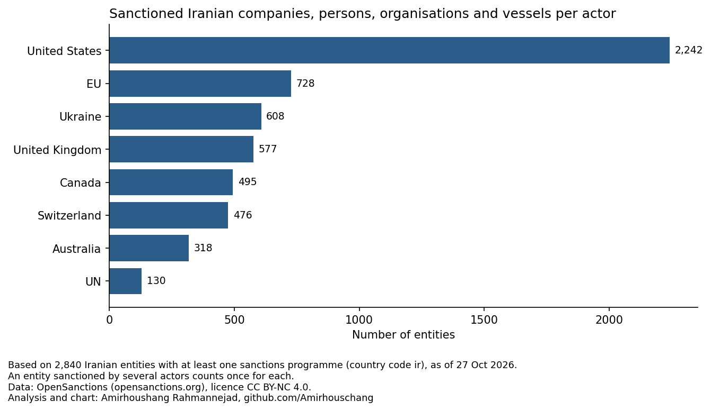

# Sanctions against Iran

🇩🇪 [Deutsche Version](README.md)

Analysis of sanctions against Iran on two levels:

- **Sanction cases (GSDB), 1979–2025:** all recorded sanction cases against Iran and their place in global sanction activity: who imposed sanctions, with which instruments, for which reasons, and with what result.
- **Who is targeted (OpenSanctions), as of 27 Oct 2026:** which Iranian companies, persons, organisations and vessels are on sanctions lists today, in which sectors and with which offices.

## Interactive dashboard

**[Open the dashboard](https://iran-sanctions-analysis.streamlit.app/)**: all results interactively, in English and German, with search and filters for the listed entities.
To run it locally, see [How to run](#how-to-run).

## Part 1: Sanction cases (GSDB)

### 1. How did sanctions against Iran develop, and who imposed them?

- Iran is the **second most sanctioned country** in the world: 62 cases since 1979, after Russia (75).
- 1979–2005: mostly 1–3 cases in force, none in 1982–1983; all imposed by the US.
- 2006–2015: strong increase during the nuclear dispute (UN, EU and others), up to 20 cases in force in 2012–2015.
- 2016: when the nuclear agreement (JCPOA) was implemented in January 2016, 13 cases ended; at the end of 2016 only 7 were still in force.
  The chart counts every case in force at any time during a year, so it shows 25 for 2016 and the drop only in 2017.
- 2018–2025: new increase after the US withdrawal, highest level of **36 cases in force in 2025**.
- The US imposed 25 of the 62 cases. China, Russia, India, Saudi Arabia and Turkey do not appear as senders of any case against Iran (UN cases are counted separately).

[](images/timeline.png)

### 2. Which instruments were used?

- Trade sanctions are far more common against Iran than worldwide (71% vs. 41% of cases).
- Financial sanctions rose from one in three new cases (1979–2005) to almost nine in ten (2017–2025).
- Among the 43 financial sanction cases, asset freezes (86%) and bans on financial services (81%) dominate. Restrictions on payment infrastructure (e.g. SWIFT) are recorded in only two cases, both by the EU (2012, 2025).

[](images/instruments.png)
[](images/financial_measures.png)

### 3. Why were sanctions imposed, and how did they end?

- Declared objectives (a case can have several): nuclear / threat to peace 24, policy change 16, human rights 15, terrorism 14, other objectives 8.
- At the end of 2025, 36 of 62 cases are still in force.
- All 10 assessed objectives on terrorism and human rights **failed**.
- Nuclear / threat to peace: 14 of 17 assessed objectives are coded as "full success", i.e. Iran fully accepted the demands.
  13 of them belong to cases that ended in January–May 2016, after the JCPOA was implemented; one ended in 2020.
  The rating is made when a case ends and should be read with caution: the dispute was not resolved,
  and the US (2018), the UN and the EU (both 2025) imposed sanctions again.

[](images/outcomes.png)

### 4. How does Iran compare globally?

| Rank | Most sanctioned countries | Cases |
|---|---|---|
| 1 | Russia | 75 |
| **2** | **Iran** | **62** |
| 3 | China | 57 |
| 4 | Belarus | 47 |
| 5 | Myanmar | 42 |

| Rank | Sanctioning countries | Cases | of which as EU/EEC member |
|---|---|---|---|
| 1 | United States | 686 | – |
| 2 | United Kingdom | 261 | 141 |
| **3** | **Germany** | **241** | **203** |
| 4 | France | 240 | 203 |
| 5 | Denmark, Netherlands | 222 each | 204 |

Cases of the EU and of its predecessor, the EEC, are assigned to the countries that were members when the case began.
The EU (190 cases) and the UN (88 cases) are not countries and are counted separately.
Germany's 241 cases include one case of the former GDR; without it, Germany and France share rank 3 with 240 cases each.

- Counted as a single actor, the **EU** is the second largest sanctioning actor after the US (190 vs. 686 cases; the UK has 120 cases of its own).
  Iran is among its most sanctioned targets: 8 cases, rank 3 together with Myanmar, after Belarus (12) and Russia (11).
- **Germany** ranks third worldwide (241 cases incl. EU and EEC sanctions). Against Iran it acts through the EU and the E3,
  which triggered the return of the UN sanctions in 2025.

**Case counts show recorded sanction episodes, not how severe the sanctions were.**

## Part 2: Who is targeted? (OpenSanctions)

Snapshot of 27 Oct 2026, filtered on country code `ir`. This part counts individual listed entities, not sanction cases.

### 5. Who sanctions Iranian entities?

- 4,972 Iranian entries in OpenSanctions, of which **2,840 are sanctioned** (1,316 persons, 1,323 companies and organisations, 201 vessels).
  The others are mainly politically exposed persons (PEPs) without sanctions.
- The **US** sanctions 2,242 of the 2,840 entities (79%), followed by the EU (728), Ukraine (608), the United Kingdom (577) and Canada (495).
- Only 400 entities are listed by both the US and the EU; the EU sanctions 328 without a US counterpart.
- The US lists almost all vessels (199 of 201); the EU, Ukraine and the UK mainly sanction persons.

[](opensanctions/images/opensanctions_akteure.png)

### 6. Which sectors and offices are affected?

- Sectors of sanctioned companies, organisations and vessels: most often shipping (278), energy (162, mainly oil and petrochemicals) and banking/finance (139).
  Nuclear (82), defence (69) and the IRGC (40) together account for 191 entries.
- Offices of persons: sanctions mainly target the military and the IRGC (226), intelligence and security forces (116) and the judiciary (100), each over 90% sanctioned.
  Members of parliament (4%), of the Assembly of Experts (7%) and diplomats (8%) are rarely sanctioned.
- Sanctions therefore target the security, judicial and defence apparatus, and hardly the elected or representative institutions.

## Data sources

| Data | Source | Period |
|---|---|---|
| Sanction cases worldwide (GSDB-R5) | Felbermayr et al. (2020), *The Global Sanctions Data Base*, European Economic Review 129 | 1949–2025 |
| Financial sanction types (GSDB-FS) | Yotov et al. (2026), *Financial Sanctions and International Trade*, CGPA Working Paper 2026014, Drexel University | 1950–2025 |
| Listed entities and offices | OpenSanctions (2026), *Default Dataset* (`targets.simple.csv`, `targets.nested.json`), [opensanctions.org](https://www.opensanctions.org/), licence CC BY-NC 4.0 | Snapshot 27 Oct 2026 |

The GSDB is available on request at [globalsanctionsdatabase.com/data](https://www.globalsanctionsdatabase.com/data/).
Commercial use and redistribution are not permitted, so the GSDB raw data is not included here. For the GSDB, the dashboard uses only aggregated tables (counts and shares).

OpenSanctions is free for non-commercial use. The repository contains only the prepared Iran tables, without dates of birth, addresses, phone numbers, e-mails and ID numbers.

## Project structure

```
iran_sanctions_analysis.ipynb          Part 1 (GSDB): data checks, charts, interpretation, limitations, sources (German)
README.en.md                           this README (English)
dashboard/
    app.py                             Streamlit dashboard (German / English)
    data/                              aggregated tables exported by the GSDB notebook
images/                                charts part 1: <name>.png (English), <name>_de.png (German), maps as .html
opensanctions/
    01_load_opensanctions_iran.py      loads OpenSanctions and filters on Iran
    02_opensanctions_iran_analysis.ipynb   part 2: categories, actors, sectors, offices, export (German)
    03_load_opensanctions_positions.py loads offices from targets.nested.json
    data/                              prepared tables for the dashboard
    images/                            charts part 2 (English and German)
.streamlit/config.toml                 dashboard theme (light)
requirements.txt
```

## How to run

**Part 1 (GSDB):** request the GSDB data and save the files as `GSDB-R5/GSDB-R5.csv` and `GSDB-FS/GSDB-FS.csv` in the project folder. `requirements.txt` covers the dashboard;
the notebook additionally needs matplotlib, country_converter and Jupyter:

```
pip install -r requirements.txt matplotlib country_converter notebook
jupyter notebook iran_sanctions_analysis.ipynb    # run all cells; exports dashboard/data and images
```

**Part 2 (OpenSanctions):** in the folder `opensanctions/` (downloads the data directly from OpenSanctions, several GB):

```
python 01_load_opensanctions_iran.py
python 03_load_opensanctions_positions.py
jupyter notebook 02_opensanctions_iran_analysis.ipynb    # run all cells; exports opensanctions/data
```

**Dashboard:**

```
streamlit run dashboard/app.py
```

## Limitations

**Part 1 (GSDB)**
- Case counts are not a measure of severity: a comprehensive embargo counts as one case, a step-by-step escalation as several.
- Outcome ratings are assessments made when a case ends, based on government statements and press reports.
- End dates are GSDB codings: an ended case does not always mean the sanctions ended. For example, the EU human-rights sanctions
  against Iran from 2011 are coded as ended in 2016, although the EU has extended this regime every year ([Council of the EU, 2026](https://www.consilium.europa.eu/en/press/press-releases/2026/03/30/human-rights-in-iran-council-extends-sanctions-regime-until-april-2027/)).
- The data records which measures were imposed, not their economic or humanitarian impact.
- For Iran, the data starts in 1979.

**Part 2 (OpenSanctions)**
- Snapshot of 27 Oct 2026; OpenSanctions is updated several times a day. No sanction date is included, so no development over time can be derived.
- Filtered on country code `ir`. Entities linked to Iran but assigned only to another country (e.g. front companies in the UAE) are missing.
- Categories, sectors and office groups are the author's own keyword-based classification, not an official industry or office code; individual misassignments are possible, and 16% of companies, organisations and vessels remain without a sector.
- PEP data from Wikidata includes former office holders.

## How this project was made

I chose the questions, the data and the methods, and checked the results against the data, the GSDB codebooks and the OpenSanctions documentation.
AI (Claude) helped with writing code and texts. How I work with AI: [local-ai-workflow](https://github.com/Amirhouschang/local-ai-workflow)

## Rights

© 2026 Amirhoushang Rahmannejad. All rights reserved. Code, texts and charts may be viewed and checked, but not copied or reused.
Feedback is welcome via issues. The GSDB data belongs to the GSDB team at Drexel University.
The OpenSanctions data in `opensanctions/data/` comes from OpenSanctions and is licensed under [CC BY-NC 4.0](https://creativecommons.org/licenses/by-nc/4.0/).
